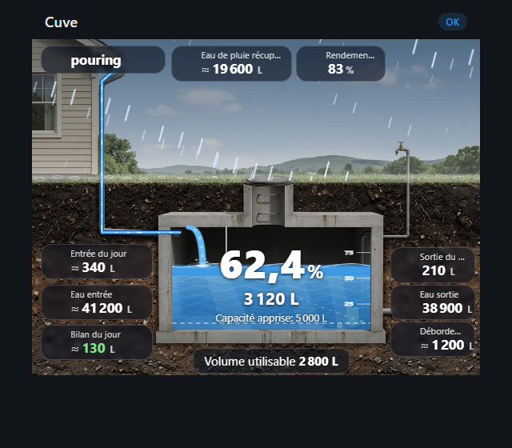
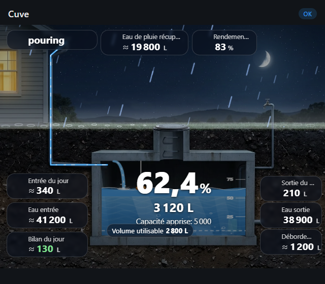

# Eco Water Tank Card

[](https://github.com/hacs/integration)
[](https://github.com/Rimfire03/eco-water-tank-card/releases)
[](LICENSE)

Lovelace card for water tanks, made for the [Eco Water Tank](https://github.com/Rimfire03/eco-water-tank) integration but **usable without it**, with any sensors and units. No dependencies.

<p align="center">
  
  
</p>

- Photo-realistic cross-section (day and night pictures bundled): buried concrete tank, downspout, pump. Animated water, inflow pipe, float, rain and all the data (level, volume, in/out, rain, overflow, usable volume) sit on the picture
- Rain falls on the scene when it rains; more drops and a thicker, faster flow in the pipe as intensity grows
- Day, dusk and night sky (from `sun.sun`, else the clock)
- Level %, volume, learned capacity, usable volume
- Water in / out today and total, net balance of the day (≈ marks estimated values)
- Rain section: collected, overflow, learned efficiency (only if rain gauge configured)
- Collapsible calibration: real volume / fill, apply, tank full / empty, share
- Only shows what your tank has. Labels, states and weather terms come from Home Assistant (your language); only a few card-specific texts are translated (fr, en)

## Install

HACS → Custom repositories → add this repo, type **Dashboard** → install. Reload the browser.

Manual: copy `dist/eco-water-tank-card.js` to `config/www/` and add it as a dashboard resource (`/local/eco-water-tank-card.js`, JavaScript module).

## Use

Add the card from the picker (**Eco Water Tank**) and choose the device, or in YAML:

```yaml
type: custom:eco-water-tank-card
device: <device id>   # or: entity: sensor.cuve_level (any entity of the tank)
name: Cuve            # optional
rain_entity: sensor.pluviometre   # optional, see below
sun_entity: sun.sun   # optional
```

Entities are found through the device, whatever their names. To override them:

```yaml
type: custom:eco-water-tank-card
entities:
  level: sensor.cuve_level
  volume: sensor.cuve_volume
  # also: capacity, usable_volume, water_in, water_in_estimated, water_out,
  # water_out_today, water_in_today, water_in_estimated_today, rain_in, overflow,
  # rain_efficiency, calibrate_volume, calibrate_percent, apply_correction,
  # mark_full, mark_empty, share_tank
```

## Use without the integration

Give the card your own entities (any integration, ESPHome, MQTT, Shelly...):

```yaml
type: custom:eco-water-tank-card
name: Rain tank
level_entity: sensor.tank_distance    # %, height, distance or volume
level_empty: 150                      # reading when empty (height/distance sensors)
level_full: 20                        # reading when full
capacity: 5                           # litres, or in capacity_unit / the unit of your volume sensor
capacity_unit: m³                     # optional: L, m³, gal, ft³
pump_limit: 0.2                       # optional: volume the pump can never draw
inlet_entity: sensor.water_in         # optional: total (L, m³, gal...) or flow (L/min, m³/h, gpm...)
outlet_entity: sensor.water_out       # optional: total or flow
pump_entity: switch.pump              # optional: switch, or a power sensor in W
rain_entity: sensor.rain_rate         # optional
weather_entity: weather.home          # optional
volume_unit: L                        # display unit: L, m³, gal, ft³ (default: your HA unit system)
```

- **Level** (`level_entity`): a `%` sensor is used as is. A height or distance sensor (m, cm, mm, in, ft...) needs `level_empty` and `level_full` (its readings when empty and full; works for ultrasonic sensors that measure the distance to the water), or `tank_height` for a height sensor. A volume sensor (L, m³, gal, ft³...) needs `capacity`.
- **Volume** (`volume_entity`): optional if the level and a `capacity` are known; otherwise the card shows the volume from the sensor and derives the percentage from `capacity`.
- **Water in / out**: a counter (L, mL, m³, ft³, gal...) gives the total and **today's total** (read from the recorder history since midnight). A flow meter (L/min, L/h, m³/h, gal/min, gpm...) shows the instant flow instead.
- **Pump**: animated while `pump_entity` is on (or its power exceeds `pump_threshold`, default 5 W), while a flow meter reads above 0, or while the "water out" counter keeps rising.
- **Rain**: `rain_entity` can be an intensity sensor (mm/h, in/h, mm/min...), a cumulative gauge (mm, cm, in), or a rain binary sensor; `weather_entity` uses the weather state (rainy, pouring, lightning-rainy...). Both can be set.
- **Units**: volumes are converted from L, mL, cL, dL, hL, m³, ft³, gal (US), imp gal, fl. oz., CCF; heights and rain from mm, cm, dm, m, in, ft, yd. The card displays litres or gallons following your Home Assistant unit system, or `volume_unit` (L, m³, gal, ft³).
- Any key of the `entities` map below also works without the integration, for example `rain_in` or `overflow`.

## Photo background

The card ships with a day and a night picture (`src/images/`, bundled into `dist/` at build time). Use your own with `image` / `image_night`, or set `photo: false` for the drawn scene. Prompts, alignment (`tank`, `pipe`, `debug`): see [IMAGE-PROMPTS.md](IMAGE-PROMPTS.md).

## Flow and rain intensity: learned maximum

The thickness and speed of the water in the pipe, and the amount of rain, show the current flow **relative to the highest flow ever seen on that source**:

- The first time, the card reads the recorder history (45 days) and takes the highest flow as the maximum: the statistics `max` of an intensity or flow sensor, or, for a cumulative counter (gauge, inlet meter), the highest rise over 10 minutes.
- It then keeps learning: any flow above the maximum becomes the new maximum. The maximum is stored in your Home Assistant user data (shared between your devices, with a `localStorage` fallback).
- Without history yet, the reference is a "heavy" flow (10 mm/h of rain, or 10 % of the capacity per hour).
- Sources: `rain_entity`, `weather_entity` (fixed intensity per weather state), the integration's rainwater estimate, and the inlet meter (`inlet_entity`), whose flow moves the pipe even without rain.

## Rain and night

- Rain: set `rain_entity` to your rain gauge (a mm/h sensor, or a cumulative mm counter; intensity comes from how fast it rises, 10 mm/h = heavy). Without it, the card uses the integration's "Rainwater collected" sensor. It stops raining 12 min after the last increase.
- Day/dusk/night: from the sun elevation of `sun.sun` (or `sun_entity`); without a sun entity the card uses the browser clock.

## Development

Source in `src/`, built file in `dist/` (what HACS serves). The `build` script of `package.json` writes it and sets the version `x.yy` from the commit count (`-dev` suffix on the `dev` branch), like the other cards. Push a tag `vX.YY` to publish a release.
